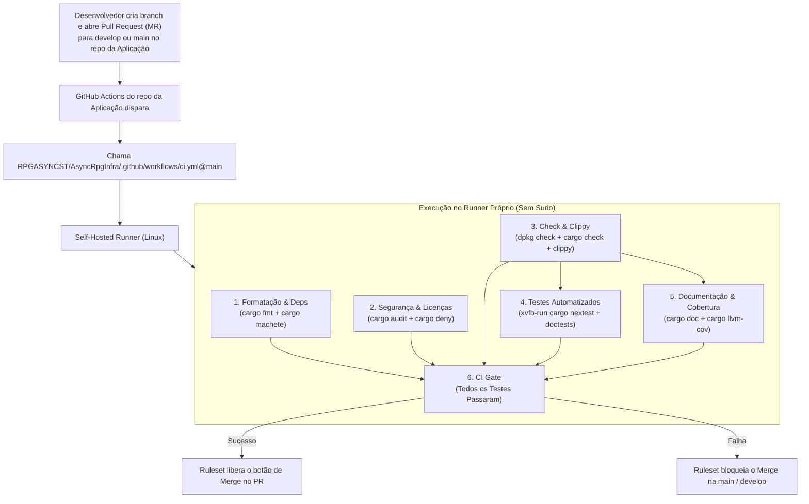

# AsyncRpgInfra — Pipeline Centralizada de CI (Rust & Iced)

Repositório central de infraestrutura de Integração Contínua (CI), qualidade de código e auditoria de segurança da organização **`RPGASYNCST`** para aplicações desenvolvidas em **Rust** utilizando **Iced** e múltiplas dependências.

Este repositório funciona como um **Reusable Workflow (`workflow_call`)** executado em **Runner Próprio (Self-Hosted Linux)** sem necessidade de `sudo` durante a execução dos jobs.

---

## 1. Fluxo Completo da Arquitetura



---

## 2. Estrutura deste Repositório

Quando qualquer repositório de aplicação chama esta pipeline, os arquivos de configuração abaixo são injetados automaticamente no workspace caso o repositório da aplicação não possua uma versão própria:

| Arquivo | Função |
| :--- | :--- |
| [`.github/workflows/ci.yml`](.github/workflows/ci.yml) | Workflow reutilizável (`workflow_call`) com todos os jobs de validação, testes, cobertura e gatekeeper. |
| [`rustfmt.toml`](rustfmt.toml) | Regras padronizadas de formatação (`edition = "2021"`, `max_width = 100`, reordenação de imports). |
| [`clippy.toml`](clippy.toml) | Limites de complexidade cognitiva e permissão de `unwrap`/`expect`/`dbg!` apenas em testes. |
| [`deny.toml`](deny.toml) | Regras do `cargo-deny`: auditoria de advisories, bloqueio de wildcards e licenças permitidas pela árvore gráfica do **Iced / wgpu**. |
| [`.config/nextest.toml`](.config/nextest.toml) | Perfil `ci` do `cargo-nextest` com *retries* para testes instáveis, timeouts e exportação de relatório JUnit (`junit.xml`). |
| [`.cargo/config.toml`](.cargo/config.toml) | Configura o linker **`lld`** via `clang` no Linux (acelerando a compilação/linkagem pesada do Iced) e atalhos locais do Cargo. |

---

## 3. O que cada Job da Pipeline Valida

1. **`Formatação (fmt) & Dependências (machete)`** (`fmt-and-deps`):
   - `cargo fmt --all -- --check`: Falha se houver qualquer arquivo fora do padrão do `rustfmt.toml`.
   - `cargo machete --with-metadata`: Detecta dependências declaradas no `Cargo.toml` que não estão sendo usadas no código.
2. **`Segurança (audit) & Licenças (deny)`** (`security-and-licenses`):
   - `cargo audit`: Verifica o `Cargo.lock` contra o banco de vulnerabilidades CVE do RustSec.
   - `cargo deny check advisories bans licenses sources`: Garante que nenhuma dependência usa licenças restritivas não autorizadas, versões banidas ou fontes desconhecidas.
3. **`Check & Clippy (Iced + Deps)`** (`lint-and-check`):
   - Verifica com `dpkg -s` (em user-space, sem `sudo`) se todos os pacotes nativos do Linux exigidos pelo **Iced** (`wayland`, `x11`, `xkbcommon`, `vulkan`, `mesa`, `alsa`, `freetype`, `fontconfig`, `lld`, `xvfb`) estão instalados no runner.
   - `cargo check --workspace --all-targets --all-features --locked`: Valida a compilação de todos os alvos.
   - `cargo clippy`: Análise estática rigorosa com `-D warnings` (qualquer warning reprova a pipeline) e alertas para `dbg!`, `todo!`, `unimplemented!` e `unwrap()`.
4. **`Testes (nextest + doctests)`** (`test`):
   - `xvfb-run --auto-servernum cargo nextest run`: Executa os testes unitários e de integração dentro de um display gráfico virtual X11 (`Xvfb`), permitindo que testes que inicializem janelas/contextos do **Iced / winit** rodem em um servidor sem monitor.
   - `cargo test --doc`: Executa os testes da documentação.
   - Salva o relatório `junit.xml` como artefato da execução.
5. **`Documentação e Cobertura`** (`docs-and-coverage`):
   - `cargo doc --no-deps --document-private-items`: Garante que a documentação gera sem warnings ou links quebrados (`RUSTDOCFLAGS="-D warnings"`).
   - `cargo llvm-cov nextest`: Calcula a cobertura de testes e publica o arquivo `lcov.info` como artefato.
6. **`CI Gate (Todos os Testes Passaram)`** (`ci-gate`):
   - Job consolidador que verifica se todos os 5 jobs anteriores passaram com `success`. Serve como check único para proteção de branches.

---

## 4. Preparação do Servidor Linux (Self-Hosted Runner)

Como a pipeline roda **100% sem `sudo`**, o administrador deve preparar a máquina Linux **uma única vez**:

### 4.1. Instalar pacotes nativos do Iced e compilação (com usuário que possui `sudo`)
```bash
sudo apt-get update && sudo apt-get install -y --no-install-recommends \
  curl git ca-certificates tar jq \
  build-essential pkg-config cmake clang lld \
  libssl-dev libudev-dev libasound2-dev libexpat1-dev \
  libfreetype6-dev libfontconfig1-dev libxcb1-dev \
  libxcb-render0-dev libxcb-shape0-dev libxcb-xfixes0-dev \
  libxkbcommon-dev libxkbcommon-x11-dev libwayland-dev \
  libx11-dev libxcursor-dev libxi-dev libxrandr-dev \
  libinerama-dev libgl1-mesa-dev libvulkan-dev xvfb
```

### 4.2. Instalar o Rust no usuário do Runner (sem `sudo`)
Logado no usuário Linux que executará o serviço do runner:
```bash
curl --proto '=https' --tlsv1.2 -sSf https://sh.rustup.rs | sh -s -- -y --default-toolchain stable --component rustfmt,clippy,llvm-tools-preview
source "$HOME/.cargo/env"
```

### 4.3. Registrar o Runner na Organização `RPGASYNCST`
1. No GitHub da organização `RPGASYNCST`, acesse **Settings → Actions → Runners → New runner** (ou diretamente no repositório da aplicação) e escolha **Linux x64**.
2. Execute o `./config.sh` conforme as instruções da página (mantenha as labels padrão `self-hosted,linux`).
3. Instale e inicie como serviço para rodar em background e iniciar junto com o servidor:
   ```bash
   sudo ./svc.sh install <usuario-do-runner>
   sudo ./svc.sh start
   ```

---

## 5. Como Conectar o Repositório da Aplicação a esta Pipeline

### 5.1. Liberar o acesso no `AsyncRpgInfra`
No repositório `RPGASYNCST/AsyncRpgInfra` no GitHub:
1. Vá em **Settings → Actions → General**.
2. Na seção **Access**, marque **Accessible from repositories in the 'RPGASYNCST' organization** e clique em **Save**.
*(Nota: se o `AsyncRpgInfra` for privado e a organização estiver no plano Free sem compartilhamento de Actions privadas, crie um Personal Access Token com permissão de leitura em `Contents` e adicione como Secret `INFRA_TOKEN` no repositório da aplicação).*

### 5.2. Adicionar o arquivo de chamada no repositório da Aplicação
No repositório onde está o código Rust da sua aplicação:
1. Certifique-se de que o arquivo **`Cargo.lock` está commitado no Git** (não ignore o `Cargo.lock` no `.gitignore`, pois `--locked` e `cargo audit` dependem dele).
2. Crie o arquivo **`.github/workflows/ci.yml`** com o conteúdo abaixo:

```yaml
name: CI

on:
  push:
    branches: [main, develop]
  pull_request:
    branches: [main, develop]
  workflow_dispatch:

jobs:
  pipeline:
    uses: RPGASYNCST/AsyncRpgInfra/.github/workflows/ci.yml@main
    secrets: inherit
```

---

## 6. Como Bloquear Merge Direto na `main` e `develop` (Exigir PR + Pipeline)

Para garantir que ninguém faça `git push` direto para `main` ou `develop` e que todo código só entre via **Pull Request (MR)** com a **pipeline aprovada**:

1. Acesse o repositório da **Aplicação** no GitHub e vá em **Settings → Rules → Rulesets**.
2. Clique em **New ruleset → New branch ruleset**.
3. Preencha:
   - **Ruleset Name**: `Protecao main e develop`
   - **Enforcement status**: **Active**
   - **Bypass list**: Deixe vazia (assim a regra vale inclusive para administradores).
4. Em **Target branches**:
   - Clique em **Add target → Include default branch** (`main`).
   - Clique em **Add target → Include by pattern** → digite `develop` e confirme.
5. Em **Branch rules**, marque:
   - **[x] Restrict deletions**
   - **[x] Require a pull request before merging**
     - Defina o número de aprovações desejado (`Required approvals`).
     - Marque **Dismiss stale pull request approvals when new commits are pushed**.
   - **[x] Require status checks to pass**
     - Marque **Require branches to be up to date before merging**.
     - Clique em **+ Add checks** e selecione:
       - **`pipeline / CI Gate (Todos os Testes Passaram)`**
   - **[x] Block force pushes**
6. Clique em **Create**.

> **Nota:** O status check `pipeline / CI Gate (Todos os Testes Passaram)` aparecerá na busca do **+ Add checks** assim que a pipeline rodar pela primeira vez no repositório da aplicação.

---

## 7. Rodando as Verificações Localmente (Antes do Push)

Para validar o código na sua máquina antes de abrir um Pull Request:

```bash
# 1. Verificar formatação
cargo fmt --all -- --check

# 2. Verificar dependências não utilizadas
cargo machete --with-metadata

# 3. Verificar vulnerabilidades e licenças
cargo audit
cargo deny check advisories bans licenses sources

# 4. Rodar Clippy com as mesmas flags da pipeline
cargo clippy --workspace --all-targets --all-features --locked -- \
  -D warnings \
  -W clippy::dbg_macro \
  -W clippy::todo \
  -W clippy::unimplemented \
  -W clippy::unwrap_used \
  -W clippy::inefficient_to_string \
  -W clippy::needless_pass_by_value

# 5. Executar testes unitários, integração e doctests
cargo nextest run --workspace --all-features --locked
cargo test --doc --workspace --all-features --locked
```

